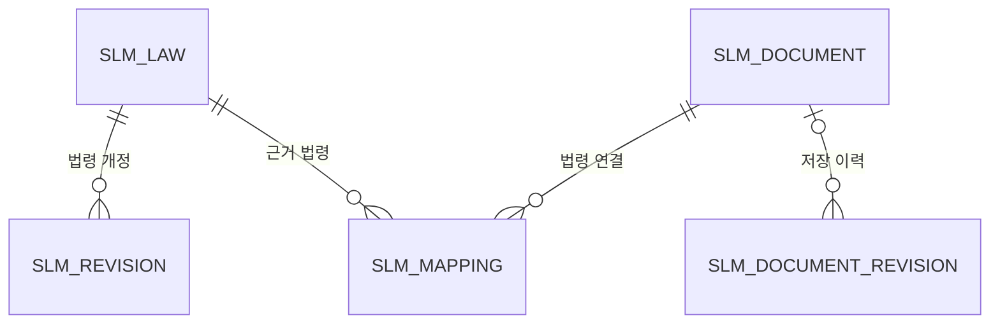

# 구조 설명

Java 17 · Spring Boot · Thymeleaf · MyBatis · Oracle을 사용한다. 로컬 프로필에서는 H2의 Oracle 호환 모드를 사용한다.

사용자 메뉴와 사용 순서는 [기능 설명](FEATURES.md), 최초 실행은 [README](../README.md)를 참고한다.

## 프로젝트 구성

```text
프로젝트 루트/
├── build.gradle                 Java·Spring Boot·MyBatis 의존성과 JAR 구성
├── settings.gradle              Gradle 프로젝트 이름
├── gradlew / gradlew.bat         Gradle Wrapper 실행 파일
├── gradle/wrapper/              Gradle 배포 버전과 Wrapper JAR
├── README.md                    설치·실행 안내
├── docs/
│   ├── FEATURES.md              기능 설명
│   └── ARCHITECTURE.md          구조 설명
└── src/main/
    ├── java/com/company/safetylaw/
    │   ├── SafetyLawApplication.java
    │   ├── controller/          메뉴 라우팅과 REST API
    │   ├── service/             업무·트랜잭션·동기화
    │   ├── mapper/              MyBatis 인터페이스
    │   ├── domain/              DB 행과 조회 정보
    │   ├── dto/                 입력 검증과 응답 타입
    │   ├── client/              외부 API와 HTTP 처리
    │   ├── scheduler/           자동 작업 호출
    │   ├── config/              보안·백그라운드 실행기
    │   ├── security/            사번 인증 Provider·세션 사용자
    │   ├── exception/           API 오류 응답
    │   └── support/             문자열·뉴스 중복 판별 등
    └── resources/
        ├── application.yaml     공통·Oracle 설정
        ├── application-local.yaml
        ├── application-dev-login.yaml
        ├── mapper/              업무별 SQL XML
        ├── db/                  초기 스키마·증분 변경 SQL
        ├── data/demo-laws.json  로컬 예시 법령
        ├── templates/fragments/layout.html
        ├── templates/index.html 사번 입력 로그인
        ├── templates/pages/     메뉴별 Thymeleaf 화면
        └── static/              CSS·JavaScript·아이콘
```

런타임 `data/`, Gradle 캐시 `.gradle/`, 산출물 `build/`, IntelliJ 설정 `.idea/`는 Git에서 제외한다.
`src/main/resources/data/demo-laws.json`은 실행에 필요한 예시 리소스이므로 Git에 포함한다.
`src/test` 소스와 테스트 전용 의존성은 제거한 상태다. Python 런타임과 Node 빌드는 사용하지 않는다.

## 요청 처리

```text
메뉴 GET → MenuController → 업무 Service → Mapper → mapper/*.xml → DB
                       ↓
            templates/pages/*.html
                       ↓
          fragments/layout.html 공통 레이아웃

등록·수정 요청 → 업무 Controller → 검증 DTO → 업무 Service → Mapper
```

메뉴마다 URL과 Thymeleaf 템플릿을 갖는다. 목록의 검색·선택·모달·저장 등은 화면별 JavaScript가
기존 REST API를 호출한다. 공통 헤더, 메뉴, 도움말만 레이아웃에서 공유한다.

## 각 계층의 책임

| 위치 | 책임 |
| --- | --- |
| `controller` | 페이지 라우팅, HTTP 요청·응답, DTO 검증 |
| `service` | 업무 조건, 변경 이력, 트랜잭션, 동기화 처리 |
| `mapper` | 업무별 조회·저장 메서드 선언 |
| `resources/mapper` | 명시적인 테이블·컬럼과 검색·집계 SQL |
| `domain` | DB 행에 대응하는 JavaBean, 인사 뷰 조회용 `EmployeeInfo` record |
| `dto` | 외부 입력과 검색·집계 응답 타입 |
| `client` | 법령·KOSHA·RSS 등 외부 HTTP 응답 처리 |
| `scheduler` | 주기별 Service 호출 |
| `config` | 보안, 백그라운드 실행기 설정 |
| `security` | 임시 사번 인증과 `LoginUser` 세션 정보 |

범용 `DataMapper`, 테이블 정의 enum, `MonitoringService`를 제거하고 법령·사규·개정·가이드·뉴스·설정을
개별 Mapper/Service로 분리했다. Mapper 위에 같은 기능의 Repository를 추가하지 않는다.
DB 행과 수정 입력은 타입으로 구분한다. 설정의 허용된 키와 작업 진행률 같은 가변 응답에는 Map을 사용한다.

## 업무별 담당 클래스

| 업무 | Controller | Service | Mapper |
| --- | --- | --- | --- |
| 메뉴 HTML | `MenuController` | 화면에 필요한 각 업무 Service | 직접 호출하지 않음 |
| 대시보드 | `DashboardApiController` | `DashboardService` | `DashboardMapper` 및 관련 업무 조회 |
| 법령 | `LawController` | `LawService`, 등록 후 `SyncService`·`ContentService` | `LawMapper` |
| 법령 개정 | `RevisionController` | `RevisionService` | `RevisionMapper` |
| 사규 | `DocumentController` | `DocumentService` | `DocumentMapper`, `MappingMapper`, `DocumentRevisionMapper` |
| 사규 이력 | `DocumentRevisionController` | `DocumentService` | `DocumentRevisionMapper` |
| 법령 연결 | `MappingController` | `MappingService` | `MappingMapper` |
| 신규 후보 | `CandidateController` | `CandidateService`, 탐색은 `SyncService` | `CandidateMapper` |
| 본문 캐시 | `ContentController` | `ContentService` | `ContentMapper` |
| KOSHA | `GuideController` | `GuideService`, 파일은 `GuideFileService` | `GuideMapper` |
| 뉴스 | `NewsController` | `NewsService` | `NewsMapper` |
| 설정 | `SettingsController` | `SettingsService` | `SettingsMapper` |
| 동기화 | `SyncController` | `SyncService` | 관련 업무 Mapper |

`LawClient`는 법령 XML 응답을, `KoshaClient`는 KOSHA JSON 응답을 처리한다.
`RemoteClient`는 공통 외부 HTTP 요청을 담당한다. `NewsService`는 이 클라이언트로 받은 RSS/Atom을 해석한다.
`GuideFileService`는 PDF 저장·조회와 PDFBox 텍스트 추출을 담당한다.

### 화면 렌더링

`MenuController`는 메뉴별 템플릿과 모델을 반환한다. 공통 헤더 집계는 `headerCounts`,
이미 조회한 API 형태의 데이터는 `initialData`로 전달한다. 레이아웃이 이를 JavaScript 값으로 직렬화하고,
`core.js`가 최초 API 조회에 재사용한다. 변경 요청 이후에는 초기 데이터 캐시를 비운다.

`main.js`는 현재 페이지의 입력·모달 이벤트를 초기화하고 목록을 표시한다.
메뉴는 실제 URL로 이동하며, 검색·일괄 선택·저장 같은 화면 내 동작은 `fetch` 기반 API를 사용한다.
따라서 Thymeleaf의 서버 렌더링과 JavaScript 목록 갱신이 함께 있는 구조다.

### 타입과 SQL

- `LawCreateRequest`, `DocumentSaveRequest`, `GuideSaveRequest` 등은 수정 가능한 입력 필드와 검증을 정의한다.
- `Law`, `CompanyDocument`, `LawRevision` 등의 JavaBean은 DB 행을 표현하며 일부 클래스는 연결 이름·건수도 담는다.
- `LawSnapshot`은 외부 법령 조회 결과, `ContentSearchResult`·`DocumentImpact`는 화면 조회 결과를 표현한다.
- JSON의 여러 DTO와 도메인은 `snake_case`, Java 프로퍼티는 `camelCase`를 사용한다.
- Mapper 인터페이스와 XML의 namespace·statement ID가 대응한다. XML은 `classpath:mapper/*.xml`에서 읽는다.
- 입력은 `#{...}` 바인딩을 사용하며 본문·비고 등 긴 문자열은 CLOB으로 저장한다.
- 등록 ID는 공유 시퀀스 `slm_seq`로 생성한다. 설정은 `setting_key`가 PK다.

## 테이블 관계

| 테이블 | 저장 내용 | 주요 관계·구분 |
| --- | --- | --- |
| `slm_law` | 추적 법령과 현재 공포·시행 정보 | 출처·외부 ID 유일, 활성 여부로 추적 취소 |
| `slm_revision` | 법령 개정 감지와 검토 상태 | `tracked_law_id` → 법령 |
| `slm_document` | 현재 사규 정보 | 문서 종류·번호·버전·담당자·링크 |
| `slm_mapping` | 현재 사규와 근거 법령 연결 | 문서·법령 쌍 유일, 양쪽 FK |
| `slm_document_revision` | 저장 시점의 사규 스냅샷 | 문서 삭제 시 FK를 NULL로 하여 이력 보존 |
| `slm_candidate` | 신규 행정규칙 후보 | 출처·외부 ID 유일, 신규·무시·등록 상태 |
| `slm_content` | 외부 법령 본문 캐시 | 출처·외부 ID 유일, 추적 법령과 독립 저장 |
| `slm_guide` | KOSHA 목록·본문·파일 링크 | 지침번호 유일, 본문 재수집 필요 여부 |
| `slm_news` | 뉴스 제목·원문·시각·보관 여부 | 카테고리·GUID 쌍 유일 |
| `slm_setting` | 키별 설정값 | `setting_key`와 CLOB 값 |



`slm_content`는 법령 출처와 외부 ID로 본문을 캐시한다. `slm_guide`, `slm_news`,
`slm_candidate`, `slm_setting`은 각각 가이드·뉴스·신규 고시 후보·설정을 보관한다.
대시보드용 복제 테이블이나 메뉴별 법령 복제 테이블은 두지 않는다.

## 사규 저장과 이력

1. 기존 사규를 수정할 때 해당 행을 잠근다.
2. 기존 사규에 이력이 없으면 수정 전 상태를 최초 기록으로 보존한다.
3. 사규 본문 정보와 선택한 근거 법령 연결을 저장한다.
4. 저장 시점의 제목·문서 번호·버전·개정일·담당자·태그·비고·문서 링크·근거 법령 ID 목록,
   변경 사유와 변경자를 `slm_document_revision`에 기록한다.
5. 모두 한 트랜잭션으로 커밋한다. 중간에 실패하면 함께 롤백한다.

기존 `/api/mappings`에서 연결을 변경해도 사규 이력을 기록한다. 이력의 근거 법령 ID 목록은
그 시점의 연결을 설명하기 위한 스냅샷이며, 현재 관계 조회는 정규화된 `slm_mapping`을 사용한다.
이력의 변경자는 사용자 입력값이며 인증 계정 감사 로그를 의미하지 않는다.

사규 삭제 시 삭제 직전 상태를 기록하고, 이력의 문서 FK만 NULL로 변경해 내용을 남긴다.
원문 파일의 내용을 복제하는 기능은 없으므로, 링크 대상 파일이 바뀌면 과거 파일을 복원할 수 없다.

법령 검토 상태 변경은 `slm_revision`에서 처리한다. 법령 영향 메뉴는 현재 사규의 연결·태그를 기준으로
관련 법령 개정을 조회한다. 이를 사규 자체의 개정 기록과 혼동하지 않도록 메뉴를 분리했다.

## 조회와 실행 범위

법령별 연결·미검토 건수, 뉴스 검색·건수, 본문 검색, 개정 상태 필터는 SQL에서 처리한다.
대시보드의 최신 법령 목록은 조건을 적용한 후 200건을 조회한다. 사규 영향 계산은
관련 법령 ID를 먼저 정하고 개정을 조회하며, 표시 제한 때문에 오래된 개정을 빠뜨리지 않는다.
일부 이름·연결 목록 조합과 뉴스 중복 판별은 Service의 메모리에서 처리한다.
현재 구조는 단일 서버 프로세스를 기준으로 하며 모든 목록에 페이지네이션을 구현한 것은 아니다.

PDF 업로드는 파일 저장과 DB 갱신 실패 시 이전 파일을 복원하도록 처리한다.
파일과 DB는 하나의 원자적 저장소가 아니므로 프로세스 강제 종료까지 같은 트랜잭션으로 묶이지는 않는다.

정기 실행은 `MonitoringScheduler`, 전체 본문 캐시는 Spring 관리 실행기와 `ContentService`가 담당한다.
컨트롤러에서 스케줄러나 스레드를 직접 생성하지 않는다.

## 동기화와 자동 실행 구조

`SafetyLawApplication`의 `@EnableScheduling`으로 `MonitoringScheduler`를 활성화한다.

| 작업 | 담당 메서드 | 예약 방식 |
| --- | --- | --- |
| 법령 개정·본문·후보 수집 | `SyncService.run()` | `app.sync-delay-ms` 초기 지연 및 완료 후 지연, 기본 24시간 |
| 뉴스 수집·정리 | `NewsService.sync()` | `app.news-delay-ms` 초기 지연 및 완료 후 지연, 기본 3시간 |
| 전체 본문 캐시 | `ContentService.start()` | 한국 시간 오전 1시, 설정 활성화 시 |

법령 자동 작업은 OC 키가 비어 있으면 생략한다. 뉴스는 로컬 모드에서 외부 수집을 생략한다.
KOSHA 목록 동기화는 예약되어 있지 않다. 서버가 종료되면 예약과 진행 중 작업도 중단되며
재시작 후 누락된 실행을 자동으로 재현하는 영속 작업 큐는 없다.

`SyncService`는 외부 최신 정보와 현재 공포번호·공포일자·시행일자를 비교하고,
새 개정 행 생성과 현재 법령 갱신을 트랜잭션으로 처리한다. 여러 법령의 전체 동기화는 하나의
트랜잭션이 아니므로 일부 실패 시 성공한 항목은 남고 응답에 오류 목록을 포함한다.

`ContentService`의 전체 캐시는 `TaskConfiguration`에서 만든 단일 실행기로 처리한다.
진행 상태와 중복 실행 방지는 프로세스 메모리 기준이다. 다중 서버 간 작업 잠금은 없다.

## 주요 API

페이지 URL은 [기능 설명](FEATURES.md)의 메뉴 표를 참고한다. 아래는 HTTP API의 주요 묶음이다.
일반적인 등록·수정 입력은 JSON이며 PDF 업로드는 `multipart/form-data`다.

| HTTP | 경로 | 처리 |
| --- | --- | --- |
| GET | `/api/health`, `/api/dashboard/summary` | 상태 응답·대시보드 집계 |
| GET / POST | `/api/laws` | 법령 목록·등록 |
| GET | `/api/laws/search`, `/api/laws/{id}` | 외부 검색·단건 |
| DELETE | `/api/laws/{id}` | 추적 비활성화 |
| GET | `/api/revisions` | 상태·법령별 개정 조회 |
| PATCH | `/api/revisions/{id}`, `/api/revisions/bulk-status` | 단건·일괄 검토 상태 |
| POST | `/api/revisions/bulk-delete` | 개정 이력 선택 삭제 |
| GET / POST | `/api/documents` | 사규 목록·등록 |
| GET / PUT / DELETE | `/api/documents/{id}` | 사규 단건·수정·삭제 |
| GET | `/api/documents/impacts`, `/api/document-revisions` | 법령 영향·사규 이력 |
| GET / POST | `/api/mappings` | 연결 조회·추가 |
| DELETE | `/api/mappings/{id}` | 연결 해제 |
| GET | `/api/laws/new-admrul-candidates/dismissed` | 무시한 후보 |
| POST | `/api/laws/new-admrul-candidates/{id}/{action}` | `dismiss`, `restore`, `registered` |
| POST | `/api/laws/new-admrul-candidates/bulk-restore` | 후보 선택 복원 |
| GET / POST | `/api/kosha-guides` | 가이드 목록·등록 |
| PUT / DELETE | `/api/kosha-guides/{id}` | 가이드 수정·삭제 |
| GET | `/api/kosha-guides/search`, `/api/kosha-guides/{id}/original` | 검색·원문 |
| POST | `/api/kosha-guides/bulk-import`, `/api/kosha-guides/bulk-delete` | 가이드 일괄 등록·삭제 |
| POST | `/api/kosha-guides/sync`, `/api/kosha-guides/cache-content` | 가이드 목록·본문 수집 |
| GET / POST / DELETE | `/api/kosha-guides/{id}/file` | PDF 열기·첨부·첨부 삭제 |
| GET | `/api/content-cache/status`, `/api/content-cache/search`, `/api/content-cache/full-refresh-status` | 캐시 현황·검색·진행 조회 |
| POST | `/api/content-cache/refresh`, `/api/content-cache/full-refresh` | 본문 갱신·전체 작업 시작 |
| GET | `/api/news`, `/api/news/search` | 뉴스 목록·검색 |
| PATCH / POST | `/api/news/{id}/archive` / `/api/news/sync` | 보관 상태·수집 |
| GET / PUT | `/api/settings` | 설정 조회·저장 |
| GET / POST | `/api/settings/help-shown` | 최초 도움말 표시 상태 |
| POST | `/api/sync` | 법령 개정·추적 본문·후보 수집 |

건수 제한과 기본값은 각 Controller·Service에서 정의한다. 모든 API가 페이지 번호를 지원하는 것은 아니다.

## 설정과 저장 위치

| 환경변수 | 용도·기본값 |
| --- | --- |
| `SERVER_ADDRESS` | 바인딩 주소, 기본 `127.0.0.1` |
| `SERVER_PORT` | HTTP 포트, 기본 `8080` |
| `SAFETY_LAW_DB_URL` | Oracle JDBC URL, 기본 `jdbc:oracle:thin:@localhost:1521/XEPDB1` |
| `SAFETY_LAW_DB_USERNAME`, `SAFETY_LAW_DB_PASSWORD` | Oracle 계정·비밀번호 |
| `SAFETY_LAW_FILES_DIR` | KOSHA PDF 디렉터리, 기본 `./data/kosha` |
| `DEV_LOGIN_ENABLED` | 임시 사번 로그인 활성화. 기본 false, local/dev-login 프로필은 true |
| `SESSION_COOKIE_SECURE` | HTTPS 전용 세션 쿠키 여부, 기본 false. HTTPS 운영에서는 true |
| `LAW_API_OC`, `KOSHA_GUIDE_API_KEY`, `KOSHA_GUIDE_API_URL` | 저장소 공통 API 인증정보·조회 주소를 덮어쓰는 설정값 |
| `AUTO_SYNC_DELAY_MS` | 법령 자동 작업 지연, 기본 `86400000` |
| `NEWS_FETCH_DELAY_MS` | 뉴스 자동 작업 지연, 기본 `10800000` |

기본 설정은 Oracle이다. `local` 프로필은 H2와 로컬 스키마 초기화를 적용하고 `app.demo=true`로 설정한다.
H2와 기본 첨부 경로는 **실행 작업 디렉터리 기준**이므로 실행 위치를 바꾸면 다른 데이터 경로를 사용할 수 있다.

사용자 요청에 따라 `application.yaml`에 법령 OC와 KOSHA 인증키·조회 주소가 포함되어 있다.
`SettingsService`는 공통 설정과 환경변수를 읽은 뒤 DB의 설정값으로 덮어쓴다. 우선순위는 DB > 환경변수 > 공통 설정이다. 따라서 화면에서 이미
저장한 API 키·피드 등은 환경변수만 바꿔도 바뀌지 않을 수 있다. DB에 저장한 값을 함께 확인해야 한다.
API 키는 설정 DB에 문자열로 저장되며 별도의 암호화 저장 계층은 없다.

### 접근과 오류 처리

`WebConfiguration`은 모든 업무 화면과 API에 세션 인증을 요구한다. 로그인 화면·처리 경로,
정적 CSS/JS/아이콘, 오류 처리, `/api/health`와 `/actuator/health`는 인증 예외다.
HTTP Basic과 로그인 정보 미설정 시 전체 허용하던 경로는 제거했다.
Thymeleaf가 CSRF 토큰을 전달하고 `core.js`가 변경 요청 헤더에 붙인다. 로그인·로그아웃 폼도 CSRF를 적용한다.

### 인사 뷰와 로그인 흐름

```text
GET / (또는 /index, /index.html, /login) → LoginController → templates/index.html
POST /login/employee → Spring Security formLogin 필터
                    → DevelopmentLoginProvider → EmployeeService → EmployeeMapper
                    → IS_USER_INFO_SSO_V → LoginUser를 SecurityContext/세션에 저장
                    → 저장된 메뉴 GET 주소 또는 /dashboard
POST /logout → 인증·세션 제거 → /login?logout
```

로그인 POST는 Controller에서 직접 세션을 만들지 않고 Spring Security 표준 필터를 사용한다.
인증 성공 시 세션 ID를 변경하고, 쿠키는 HttpOnly·SameSite=Lax이며 세션 유휴 만료는 30분이다.
요청 저장은 업무 화면 GET만 대상으로 하며 API·actuator 요청과 쓰기 요청은 저장하지 않는다.
미인증 API는 JSON 401, 인증 상태의 CSRF 오류는 JSON 403이다. `core.js`는 401에서 현재 화면을
다시 GET하여 로그인 후 원래 화면으로 돌아오게 한다. 실패한 쓰기를 자동 재실행하지 않는다.

| Oracle 인사 뷰 컬럼 | `EmployeeInfo` 필드 | 용도 |
| --- | --- | --- |
| `EMPCD` | `employeeCode` | 세션 사용자 식별값·사번 로그인 조회 |
| `HNAME` | `name` | 이름 표시 |
| `DEPTCDNM` | `departmentName` | 부서명 표시 |
| `HANDPHONE` | `phoneNumber` | 세션 내 연락처 정보 |
| `EMAIL` | `email` | 세션 내 이메일·향후 pid 식별 |

`EmployeeMapper.xml`은 기존 뷰를 SELECT만 한다. 인사 데이터 복제 테이블이나 Repository는 추가하지 않는다.
DB 계정에 뷰 SELECT 권한이 필요하며 다른 스키마라면 동명 synonym을 준비한다.
Oracle 스키마 SQL에는 인사 뷰 DDL을 넣지 않는다. `schema-local.sql`에만 H2 예시 뷰와 `LOCAL001`을 둔다.
중복 식별 방지를 위해 최대 두 행을 조회하고 한 명으로 식별되지 않으면 실패한다.
DB 오류는 로그인 실패 안내로 변환하며 사용자 정보나 DB 상세 오류를 화면에 노출하지 않는다.

기본 Oracle 설정에서는 임시 로그인이 꺼져 있으며 `dev-login` 프로필 또는 `DEV_LOGIN_ENABLED=true`로 켠다.
`local`은 예시 인사 정보로 임시 로그인을 켠다. 모든 로그인 사용자는 현재 `ROLE_USER`로 같은 업무 데이터를 사용한다.
사용자별 권한, 작성자 자동 기록, 인사 정보 수정 기능은 포함하지 않는다.

`EmployeeService.findForVerifiedPid`는 **실제 SSO 검증을 마친 뒤** 호출할 조회 지점이다.
사번 또는 이메일의 `@` 앞 ID(대소문자 무시)를 조회하고 여러 사용자와 일치하면 거절한다.
현재 외부 pid 파라미터나 헤더를 신뢰하는 HTTP 엔드포인트는 없다. SSO 가이드 수령 후 검증 처리와 세션 인증을 연결해야 한다.
사번 입력 자체는 비밀번호 검증이 없는 임시 접속이므로 SSO를 연결할 때 비활성화한다.

인사 정보는 로그인 시점의 스냅샷이며 세션 동안 유지된다. 같은 데이터를 함께 관리하려면 사용자는
각자 로컬 DB를 실행하는 대신 공용 애플리케이션 서버와 Oracle을 사용해야 한다.

`RemoteClient`는 공개 HTTP(S) URL을 검사하고 내부·루프백 주소 요청을 제한한다.
외부 응답은 최대 20MB이며 연결·요청 시간 제한이 있다. 외부 오류에 인증키가 포함된 URL을 그대로 노출하지 않는다.
`ApiErrors`는 입력 검증, 잘못된 JSON, 날짜, 중복 데이터, 업로드 크기와 HTTP 상태 예외를 응답으로 변환한다.

## 수정할 때 찾을 위치

| 변경하려는 내용 | 수정 위치 |
| --- | --- |
| 메뉴 이름·공통 헤더 | `templates/fragments/layout.html` |
| 특정 화면의 구성·동작 | `templates/pages/`와 대응 `static/js/` |
| 화면 URL·초기 모델 | `MenuController` |
| 입력 허용 필드·검증 | `dto/`와 해당 Controller |
| 업무 처리·저장 단위 | 해당 Service |
| 검색·정렬·집계 SQL | `resources/mapper/`와 Mapper 인터페이스 |
| 테이블 변경 | Oracle·H2 스키마 및 기존 DB용 증분 SQL |
| 자동 작업 시간·조건 | `MonitoringScheduler`, `application.yaml` |

기존 DB를 사용하는 배포에서는 초기 스키마 파일 수정만으로 DB가 바뀌지 않는다.
증분 SQL과 기존 데이터 처리 방안을 함께 제공해야 한다.

## DB 적용

- 신규 Oracle: `src/main/resources/db/schema-oracle.sql` 실행.
- 기존 Oracle: `src/main/resources/db/migration/V2__document_revision_oracle.sql`만 1회 실행.
- 기존 로컬 H2: 다음 시작 시 `schema-local.sql`의 `IF NOT EXISTS`로 신규 테이블 추가.

이번 변경 작업 중 운영 DB나 로컬 데이터 파일에는 SQL을 실행하지 않았다.
기존 Python 데이터는 별도 이관 대상이다. 이전 Python 코드, 설치 도구와 배포 설정은 제거했다.
현재 실행과 배포는 Spring Boot와 Gradle JAR를 기준으로 한다.

## 화면 공통 계층

`fragments/layout.html`은 업무별 사이드 메뉴·헤더·사용자 정보·법령 동기화·도움말을 제공합니다.
`static/css/style.css`에 색상·글꼴·간격·반응형·입력/표/팝업 기준을 모으고 로그인 전용 배치는 `login.css`에서 처리합니다.
`main.js`는 `ui.js`의 공통 메뉴와 팝업 포커스 처리를 초기화한 다음 기존 업무 모듈을 연결합니다.
팝업은 업무 모듈의 `hidden` 상태 변경을 관찰하고, 배경 비활성화에 팝업 자체가 포함되지 않도록 body 직계 자식으로 이동합니다.
대시보드 요약은 서버가 렌더링한 링크를 유지하면서 숫자만 갱신합니다.
`login.js`는 폼 제출 동안 로그인 버튼 중복 클릭을 방지합니다. 인증·업무 API 구조는 그대로 사용합니다.
자세한 화면 기준은 [UI/UX 구성](UI-UX.md)에 정리되어 있습니다.
