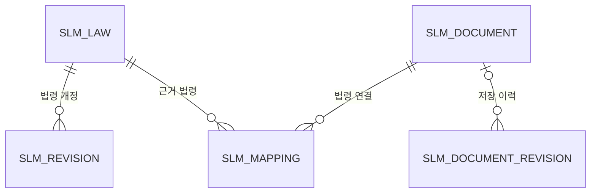

# Spring 웹 구조

Java 17 · Spring Boot · Thymeleaf · MyBatis · Oracle을 사용한다. 로컬 프로필에서는 H2의 Oracle 호환 모드를 사용한다.

## 요청 처리

```text
메뉴 GET → MenuController → 업무 Service → Mapper → mapper/*.xml → DB
                       ↓
            templates/pages/*.html
                       ↓
          fragments/layout.html 공통 레이아웃

등록·수정 요청 → 업무 Controller → 검증 DTO → 업무 Service → Mapper
```

메뉴마다 URL과 Thymeleaf 템플릿을 갖는다. 목록의 검색·선택·모달·저장 등은 화면별 JavaScript가
기존 REST API를 호출한다. 공통 헤더, 메뉴, 도움말만 레이아웃에서 공유한다.

## 각 계층의 책임

| 위치 | 책임 |
| --- | --- |
| `controller` | 페이지 라우팅, HTTP 요청·응답, DTO 검증 |
| `service` | 업무 조건, 변경 이력, 트랜잭션, 동기화 처리 |
| `mapper` | 업무별 조회·저장 메서드 선언 |
| `resources/mapper` | 명시적인 테이블·컬럼과 검색·집계 SQL |
| `domain` | DB 행에 대응하는 JavaBean |
| `dto` | 외부 입력과 검색·집계 응답 타입 |
| `client` | 법령·KOSHA·RSS 등 외부 HTTP 응답 처리 |
| `scheduler` | 주기별 Service 호출 |
| `config` | 보안, 백그라운드 실행기 설정 |

범용 `DataMapper`, 테이블 정의 enum, `MonitoringService`를 제거하고 법령·사규·개정·가이드·뉴스·설정을
개별 Mapper/Service로 분리했다. Mapper 위에 같은 기능의 Repository를 추가하지 않는다.
DB 행과 수정 입력은 타입으로 구분한다. 설정의 허용된 키와 작업 진행률 같은 가변 응답에는 Map을 사용한다.

## 테이블 관계



`slm_content`는 법령 출처와 외부 ID로 본문을 캐시한다. `slm_guide`, `slm_news`,
`slm_candidate`, `slm_setting`은 각각 가이드·뉴스·신규 고시 후보·설정을 보관한다.
대시보드용 복제 테이블이나 메뉴별 법령 복제 테이블은 두지 않는다.

## 사규 저장과 이력

1. 기존 사규를 수정할 때 해당 행을 잠근다.
2. 기존 사규에 이력이 없으면 수정 전 상태를 최초 기록으로 보존한다.
3. 사규 본문 정보와 선택한 근거 법령 연결을 저장한다.
4. 저장 시점의 제목·문서 번호·버전·개정일·담당자·태그·비고·문서 링크·근거 법령 ID 목록,
   변경 사유와 변경자를 `slm_document_revision`에 기록한다.
5. 모두 한 트랜잭션으로 커밋한다. 중간에 실패하면 함께 롤백한다.

기존 `/api/mappings`에서 연결을 변경해도 사규 이력을 기록한다. 이력의 근거 법령 ID 목록은
그 시점의 연결을 설명하기 위한 스냅샷이며, 현재 관계 조회는 정규화된 `slm_mapping`을 사용한다.
이력의 변경자는 사용자 입력값이며 인증 계정 감사 로그를 의미하지 않는다.

사규 삭제 시 삭제 직전 상태를 기록하고, 이력의 문서 FK만 NULL로 변경해 내용을 남긴다.
원문 파일의 내용을 복제하는 기능은 없으므로, 링크 대상 파일이 바뀌면 과거 파일을 복원할 수 없다.

법령 검토 상태 변경은 `slm_revision`에서 처리한다. 법령 영향 메뉴는 현재 사규의 연결·태그를 기준으로
관련 법령 개정을 조회한다. 이를 사규 자체의 개정 기록과 혼동하지 않도록 메뉴를 분리했다.

## 조회와 실행 범위

법령별 연결·미검토 건수, 뉴스 검색·건수, 본문 검색, 개정 상태 필터는 SQL에서 처리한다.
대시보드의 최신 법령 목록은 조건을 적용한 후 200건을 조회한다. 사규 영향 계산은
관련 법령 ID를 먼저 정하고 개정을 조회하며, 표시 제한 때문에 오래된 개정을 빠뜨리지 않는다.
일부 이름·연결 목록 조합과 뉴스 중복 판별은 Service의 메모리에서 처리한다.
현재 구조는 단일 서버 프로세스를 기준으로 하며 모든 목록에 페이지네이션을 구현한 것은 아니다.

PDF 업로드는 파일 저장과 DB 갱신 실패 시 이전 파일을 복원하도록 처리한다.
파일과 DB는 하나의 원자적 저장소가 아니므로 프로세스 강제 종료까지 같은 트랜잭션으로 묶이지는 않는다.

정기 실행은 `MonitoringScheduler`, 전체 본문 캐시는 Spring 관리 실행기와 `ContentService`가 담당한다.
컨트롤러에서 스케줄러나 스레드를 직접 생성하지 않는다.

## DB 적용

- 신규 Oracle: `src/main/resources/db/schema-oracle.sql` 실행.
- 기존 Oracle: `src/main/resources/db/migration/V2__document_revision_oracle.sql`만 1회 실행.
- 기존 로컬 H2: 다음 시작 시 `schema-local.sql`의 `IF NOT EXISTS`로 신규 테이블 추가.

이번 변경 작업 중 운영 DB나 로컬 데이터 파일에는 SQL을 실행하지 않았다.
기존 Python 데이터는 별도 이관 대상이다. 이전 Python 코드, 설치 도구와 배포 설정은 제거했다.
현재 실행과 배포는 Spring Boot와 Gradle JAR를 기준으로 한다.
